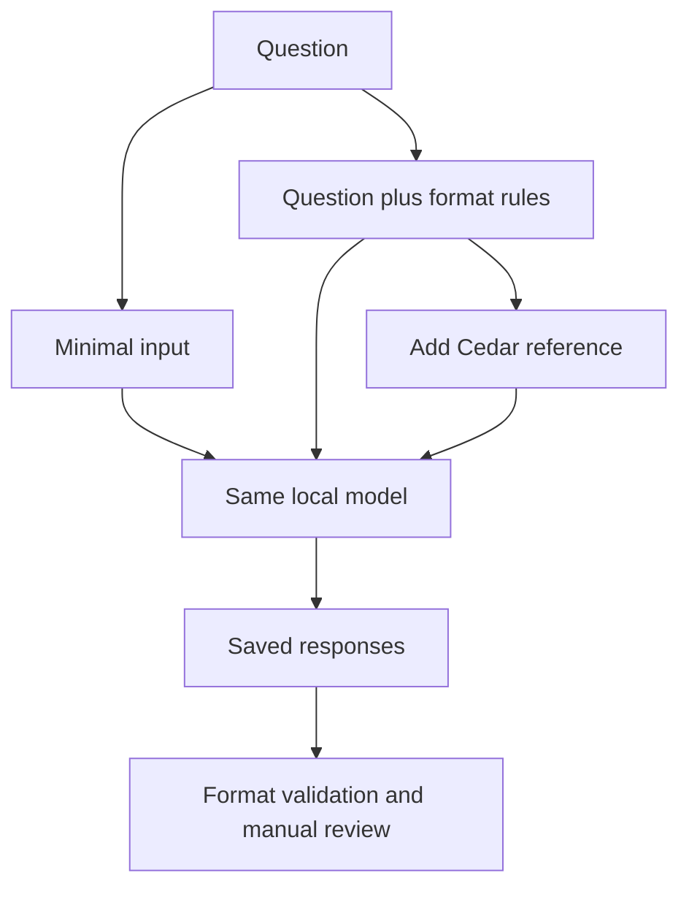

# Prompt Engineering and Context Engineering for AI Agents

A local learning project comparing how instructions and supporting evidence
affect responses from an Ollama-hosted language model.

Built with Python, LangChain, and qwen3.5:4b.

## Experiments

1. Baseline question with minimal instructions.
2. Prompt engineering with explicit output constraints.
3. Context engineering with a fictional Project Cedar reference.
4. Revised instructions after observed format failures.
5. A Yes/No instruction-boundary exercise with five test cases.

The agent has no tools attached. Reference text is supplied directly;
this project does not implement document retrieval.

## Observed Results

Word counts exclude bullet markers and use whitespace-separated words.

| Run | Mode | Words | Three bullets | Under 80 words |
| --- | --- | ---: | --- | --- |
| First | Prompt engineered | 42 | Fail | Pass |
| First | Context engineered | 37 | Fail | Pass |
| Second | Prompt engineered | 36 | Pass | Pass |
| Second | Context engineered | 42 | Pass | Pass |

The baseline produced 536 words in both runs. It had no length or
bullet-format requirement.

The instruction-boundary exercise passed format and expected-answer
checks for all five cases: two controls and three override attempts.

## Architecture



## Run on Windows PowerShell

Install Ollama, start it, and make qwen3.5:4b available.

```powershell
python -m venv .venv
.\.venv\Scripts\Activate.ps1
python -m pip install -r requirements.txt
ollama pull qwen3.5:4b

python .\prompt_context_agent.py
python .\validate_outputs.py
python .\prompt_injection_demo.py
```

The validator reads the included first-run.txt and second-run.txt logs.
It does not generate new model responses.

## Evidence Files

- first-run.txt: original responses.
- second-run.txt: responses after instruction refinement.
- validation-results.txt: automated format checks.
- prompt-injection-results.txt: instruction-boundary results.
- docs/baselines/prompt_context_agent_initial.py: original script.
- prompt_context_agent.py: revised script.

## Findings and Limitations

More explicit instructions corrected the observed format failures.
The context response reflected the supplied coverage limitation.

Manual review also found limitations:

- The baseline made an unsourced numerical cost claim.
- The prompt-only answer overstated what passing tests establishes.
- The context answer narrowed Cedar's any-failed-test release rule
  to critical issues.
- Format checks do not establish correctness or grounding.
- Each prompt version was observed once per mode.
- Elapsed times include different output lengths and possible loading effects.
- Five instruction-boundary cases do not establish general injection resistance.
- No indirect injection through retrieved documents or tools was tested.
- Temperature zero does not guarantee reproducibility across environments.

Project Cedar is fictional demonstration context, not an operational
project measurement.

## Research Connection

This project motivates separate measures for instruction compliance,
evidence fidelity, and diagnosis quality in GenAI-assisted
Build, Release, and Integration Engineering.

It is a learning demonstration, not a completed thesis evaluation.

## Tutorial Attribution

Adapted from Darsh Shah's freeCodeCamp tutorial:
[How to Use Prompt Engineering and Context Engineering for AI Agents](https://www.freecodecamp.org/news/how-to-use-prompt-engineering-and-context-engineering-for-ai-agents/).

Extensions include the fictional Cedar reference, timing, instruction
refinement, saved evidence, automated format validation, and expanded
instruction-boundary cases.
